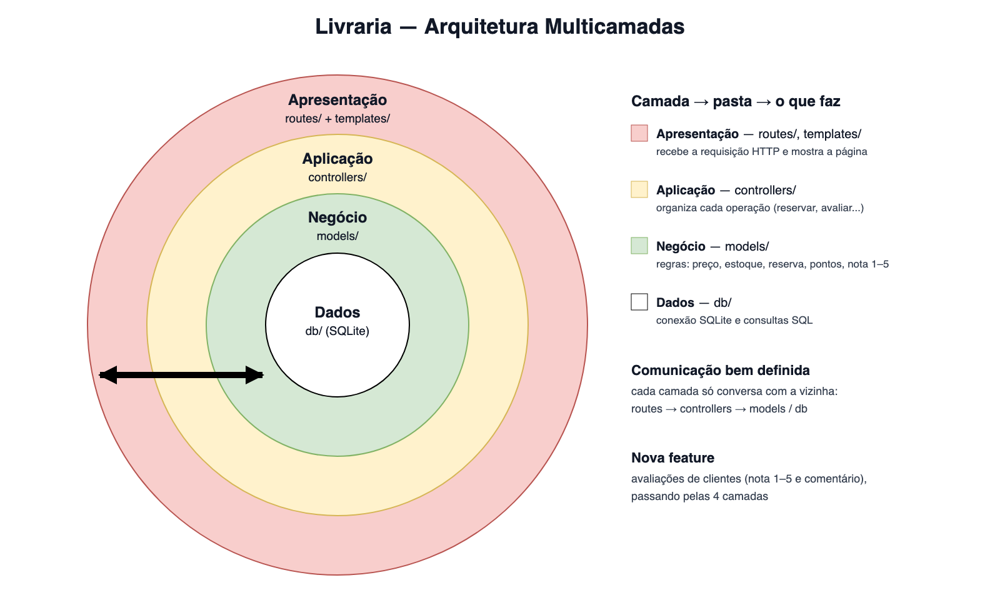

# Livraria — Exercício 7.3 (Arquitetura Multicamadas)

Continuação da livraria do [exercício 6](https://github.com/HenriqueRSouza/livraria-sdd-exercicio-6), agora organizada em 4 camadas e com uma feature nova.

## O que mudou

- O código, que antes ficava em `livraria.py` + `app.py`, foi separado em 4 camadas, cada uma em uma pasta.
- Todo o SQL ficou só na pasta `db/`, e as regras de negócio ficaram só em `livraria/models/`.
- Nova feature: avaliações de livros pelos clientes.

## Nova feature: avaliações

O cliente logado dá uma nota de 1 a 5 (com comentário opcional, até 500 caracteres) na página do livro. Cada cliente tem uma avaliação por livro, e enviar de novo substitui a anterior. A página mostra a média e a quantidade de avaliações, e a "Minha área" lista as avaliações do cliente.

## Arquitetura



```
app.py                 cria o app Flask e registra as rotas
templates/             páginas HTML
db/db.py               conexão SQLite, tabelas, dados de exemplo e consultas
livraria/
  routes/              rotas Flask (catalogo, cliente, pedidos, comunicacao, avaliacoes)
  controllers/         uma função por operação (reservar, comprar, avaliar...)
  models/              Cliente, Reserva, Avaliacao e regras (preço, pontos, busca)
tests/
```

| Camada | Pasta | O que faz |
|---|---|---|
| Apresentação | `livraria/routes/` + `templates/` | Lê o request, chama o controller e mostra a página |
| Aplicação | `livraria/controllers/` | Coordena cada operação: valida com os models e salva com o db |
| Negócio | `livraria/models/` | Regras da livraria (preço com promoção, estados da reserva, pontos, nota 1–5), sem Flask e sem SQL |
| Dados | `db/` | Única parte que fala com o SQLite |

A comunicação vai sempre de cima para baixo: routes → controllers → models / db.

## Como rodar

```sh
python3 -m venv .venv
.venv/bin/python -m pip install -r requirements.txt
.venv/bin/python app.py
```

Abra http://127.0.0.1:5000/. O arquivo `livraria.db` é criado com dados de exemplo na primeira execução.

## Testes

```sh
.venv/bin/python -m unittest discover -v
```

- `tests/test_controllers.py`: regras C01–C07 e avaliações (C09), testadas direto nos controllers.
- `tests/test_rotas.py`: navegação HTTP (C08) e avaliação pela interface.
