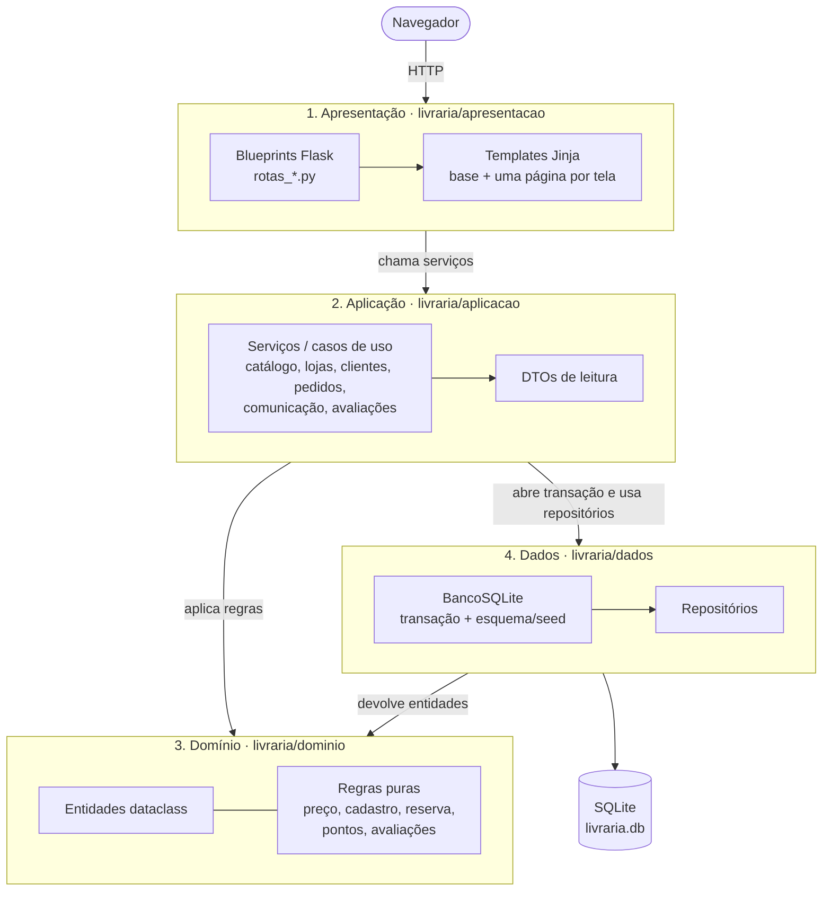

# Livraria — Exercício 7.3, Lab 07 (Arquitetura Multicamadas)

Evolução do MVP da livraria do [exercício 6](https://github.com/HenriqueRSouza/livraria-sdd-exercicio-6) para uma **arquitetura em quatro camadas**, com uma nova funcionalidade: **avaliações de clientes**. A especificação continua sendo a fonte de verdade: [docs/specs/livraria.md](docs/specs/livraria.md) (R01–R07, C01–C09) e [docs/specs/tasks.md](docs/specs/tasks.md).

## Instalar e executar

Requer Python **3.10+** e pip. Na pasta deste projeto:

```sh
python3 -m venv .venv
.venv/bin/python -m pip install -r requirements.txt
.venv/bin/python -m unittest discover -v
.venv/bin/python app.py
```

Abra **http://127.0.0.1:5000/**. Na primeira execução, `livraria.db` é criado e preenchido automaticamente. Para recomeçar, remova `livraria.db` com o servidor parado, ou use outro banco: `LIVRARIA_DB=/caminho/novo.db .venv/bin/python app.py`. `LIVRARIA_SECRET` define a chave de sessão. Bancos criados pelo exercício 6 não têm as colunas novas de avaliações: use um arquivo novo.

## Camadas



| Camada | Responsabilidade | Pode importar |
|---|---|---|
| **Apresentação** (`livraria/apresentacao`) | Fábrica Flask, blueprints, leitura de formulários, sessão, mensagens flash, filtro de moeda e templates. Não conhece SQL nem regras. | só `livraria.aplicacao` (de onde vem também `RegraInvalida`) |
| **Aplicação** (`livraria/aplicacao`) | Casos de uso (`ServicoCatalogo`, `ServicoPedidos`, `ServicoAvaliacoes`...): validam o cliente, abrem a transação, combinam repositórios e regras, montam DTOs para a tela. | `livraria.dominio`, `livraria.dados` |
| **Domínio** (`livraria/dominio`) | Entidades (`Livro`, `Reserva`, `Avaliacao`...) e regras puras: busca sem acentos, preço com promoção, validação de cadastro, transições de reserva, pontos, nota/texto e média de avaliações. | nada do projeto; sem Flask nem SQLite |
| **Dados** (`livraria/dados`) | Conexão SQLite, esquema e seed idempotentes, `UnidadeDeTrabalho` (transação com `BEGIN IMMEDIATE` para débitos atômicos) e repositórios que devolvem entidades do domínio. | `livraria.dominio` (entidades/erro) |

A direção é sempre de cima para baixo: a apresentação só fala com a aplicação; a aplicação orquestra domínio e dados; dados apenas conhece as entidades do domínio para devolvê-las. `tests/test_arquitetura.py` lê os imports com `ast` e falha se alguma camada importar o que não deve.

## Nova funcionalidade: avaliações de clientes (R07 / C09)

- No detalhe do livro, um cliente com sessão escolhe nota de **1 a 5** e, opcionalmente, um comentário de até **500 caracteres** (**Enviar avaliação**).
- Cada cliente tem no máximo uma avaliação por livro; reenviar **substitui** a anterior.
- O livro mostra **média com uma casa decimal** e quantidade, incluindo a avaliação de demonstração; **Minha área** lista as avaliações do cliente.
- Nota inválida, texto longo ou livro inexistente geram erro de domínio sem gravar nada.

Percurso: cadastre-se → abra **A Casa das Marés** → avalie com 4 → a média passa de 5,0 para 4,5 (2 avaliações) → veja em **Minha área**.

## O que mudou em relação ao exercício 6

| Exercício 6 | Exercício 7.3 |
|---|---|
| `livraria.py` com SQL, regras e transações na mesma classe | Regras em `dominio/regras.py` e métodos das entidades; SQL só em `dados/repositorios.py`; orquestração em `aplicacao/*.py` |
| Dicionários (`sqlite3.Row`) atravessando a aplicação | Entidades `dataclass` e DTOs (`DetalheLivro`, `Historico`) |
| `app.py` com todas as rotas e um `templates/index.html` com `if pagina == ...` | Blueprints por assunto e templates `base.html` + uma página por tela; `app.py` na raiz apenas inicia o servidor |
| Testes chamando `Livraria` diretamente | Testes de domínio (sem banco), de serviços (C01–C07, C09), HTTP (C08, C09) e de arquitetura |

As regras R01–R06 e os limites da demonstração (pagamento, localização e notificações simulados) continuam os mesmos do exercício 6.

## Testes

```sh
.venv/bin/python -m unittest discover -v
```

- `tests/test_dominio.py` — regras puras (preço, busca, cadastro, transições, avaliações).
- `tests/test_servicos.py` — C01–C07 pela camada de aplicação, com SQLite temporário.
- `tests/test_avaliacoes.py` — C09.
- `tests/test_app.py` — C08 e C09 via requisições HTTP ao Flask.
- `tests/test_arquitetura.py` — dependências permitidas entre camadas.
